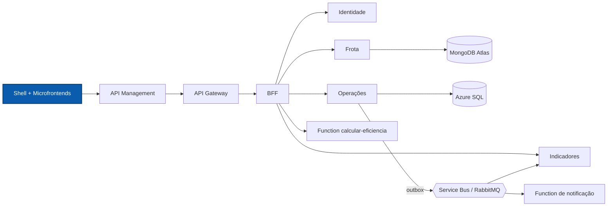

# NexFleet Frontend

Aplicação web do NexFleet: um shell React que compõe, em tempo de execução, os microfrontends de Frota, Operações e Painel.

[](https://github.com/mateusblm/nexfleet-frontend/actions/workflows/ci.yml)


---

## Visão geral

O NexFleet é uma plataforma de gestão de frotas empresariais: veículos, motoristas, vínculos, abastecimentos, manutenções, painel de custos e uma visão consolidada de eficiência.

Este repositório é a camada de apresentação. Um **shell** cuida do login, do menu e da gestão de usuários e carrega três **microfrontends** independentes (`/mfes/<nome>/remoteEntry.js` em produção; servidor Vite de cada um no desenvolvimento). Todas as chamadas vão para a API pelo Azure API Management (nuvem) ou pelo API Gateway (local). Na nuvem, tudo é servido pelo Azure Static Web Apps.



## Funcionalidades

- Login com JWT e navegação entre os módulos (shell).
- Gestão de usuários com perfis `ADMINISTRADOR` e `GESTOR_FROTA`, restrita a Administradores ativos (shell).
- Cadastro de veículos, motoristas e vínculos motorista ↔ veículo (microfrontend Frota).
- Registro de abastecimentos e manutenções (microfrontend Operações).
- **Editar** e **Excluir** no histórico de Operações: edição na própria linha, com o formulário preenchido e validação acessível (no abastecimento, só combustível, litros, valor e quilometragem); exclusão com confirmação; foco gerenciado entre leitura, edição e confirmação.
- Painel com gastos, situação da frota e próximas manutenções (microfrontend Painel).
- Cartão **Visão consolidada**, alimentado por `GET /api/v1/aggregated-data`, com aviso quando `fontes` indica uma fonte indisponível.
- Validação de formulários acessível nas telas de cadastro.
- Página **AsyncAPI** dos eventos em `/docs/eventos/`, gerada no build com o web component servido localmente (sem CDN).

## Arquitetura

Cada domínio do produto é uma aplicação independente (fatia vertical), com build, testes e servidor de desenvolvimento próprios. Dentro de cada uma, componentes de tela ficam separados dos módulos de acesso à API.

| Aplicação | Pasta | Porta (dev) | Responsabilidade |
|---|---|---|---|
| Shell | `frontend/` | 5173 | Login, menu, gestão de usuários, host dos microfrontends e página AsyncAPI |
| Frota | `microfrontends/frota/` | 5174 | Veículos, motoristas e vínculos (`veiculos-api.ts`, `motoristas-api.ts`, `vinculos-api.ts`) |
| Operações | `microfrontends/operacoes/` | 5175 | Abastecimentos e manutenções, com edição e exclusão no histórico (`HistoricoOperacoes.tsx`, `abastecimentos-api.ts`, `manutencoes-api.ts`, `alteracao-api.ts`) |
| Painel | `microfrontends/painel/` | 5176 | Painel e visão consolidada (`dashboard.ts`, `dados-agregados.ts`) |

Cada microfrontend é gerado como módulo ES (`remoteEntry.js`) e carregado pelo shell em tempo de execução (`frontend/src/remotes.ts`).

## API consumida

A aplicação consome apenas a API pública exposta pelo BFF:

| Método | Rota | Uso |
|---|---|---|
| `POST` / `GET` | `/api/v1/auth/login`, `/api/v1/auth/me` | Login e sessão |
| `GET` | `/api/v1/ambiente` | Situação do ambiente |
| `GET`, `POST`, `PUT`, `DELETE` | `/api/v1/usuarios[/{id}]` | Gestão de usuários |
| `GET`, `POST`, `PUT`, `DELETE` | `/api/v1/veiculos[/{id}]`, `/api/v1/motoristas[/{id}]` | Cadastros da frota |
| `GET`, `POST`, `PUT` | `/api/v1/vinculos`, `/api/v1/vinculos/{id}/encerramento` | Vínculos |
| `GET`, `POST`, `PUT`, `DELETE` | `/api/v1/abastecimentos[/{id}]`, `/api/v1/manutencoes[/{id}]` | Operações |
| `GET` | `/api/v1/dashboard` | Painel |
| `GET` | `/api/v1/aggregated-data` | Visão consolidada |

Documentação interativa: **[Swagger UI em produção](https://apim-nexfleet-homolog-ukzjodf42myfe.azure-api.net/swagger-ui.html)**.

## Stack

| Camada | Tecnologia | Versão |
|---|---|---|
| UI | React, React DOM | 19.3.1 |
| Linguagem | TypeScript | 7.0.2 |
| Build e dev server | Vite, `@vitejs/plugin-react` | 8.3.4 / 6.1.2 |
| Testes | Vitest, Testing Library (React, jest-dom), jsdom | 5.0.5 / 16.3.3, 7.0.1 / 30.1.3 |
| Documentação de eventos | AsyncAPI React / Web Component | 3.1.8 |
| Runtime de build | Node.js | 24 |
| Hospedagem | Azure Static Web Apps | — |
| CI | GitHub Actions | — |

## Primeiros passos

### Pré-requisitos

- Node.js 24 e npm
- Back-end em execução (ambiente completo abaixo) para usar as telas

### Testes e build

Em cada aplicação (`frontend`, `microfrontends/frota`, `microfrontends/operacoes`, `microfrontends/painel`):

```bash
npm ci
npm test
npm run build
```

### Desenvolvimento

Com o back-end rodando, um terminal por aplicação:

```bash
cd frontend && npm run dev                    # shell em http://127.0.0.1:5173
cd microfrontends/frota && npm run dev        # 5174
cd microfrontends/operacoes && npm run dev    # 5175
cd microfrontends/painel && npm run dev       # 5176
```

Este repositório não gera imagem Docker: em produção é publicado como site estático.

### Ambiente completo

O back-end inteiro (todos os serviços, SQL Server, MongoDB e RabbitMQ) sobe pelo repositório [nexfleet](https://github.com/mateusblm/nexfleet):

```bash
git clone https://github.com/mateusblm/nexfleet.git && cd nexfleet
scripts/clonar-tudo.sh                                        # clona os demais repositórios ao lado
scripts/iniciar-local.sh                                      # gera o .env e a chave RSA local
docker compose -f compose.yaml -f compose.build.yaml up -d --build
scripts/seed-demo.sh                                          # dados de demonstração
```

Depois, suba as telas com `npm run dev` e acesse `http://127.0.0.1:5173` com `LOCAL_USER_EMAIL` / `LOCAL_USER_PASSWORD` do `.env` gerado.

## Configuração

| Variável | Descrição | Padrão |
|---|---|---|
| `NEXFLEET_GATEWAY_URL` | Gateway para o proxy do servidor de desenvolvimento do shell | `http://127.0.0.1:8080` |
| `VITE_API_BASE_URL` | URL base da API no build de produção (APIM) | vazio (URLs relativas) |
| `VITE_MFE_FROTA_URL` | Endereço do microfrontend Frota | dev: `http://127.0.0.1:5174/src/entry.tsx`; build: `/mfes/frota/remoteEntry.js` |
| `VITE_MFE_OPERACOES_URL` | Endereço do microfrontend Operações | dev: `http://127.0.0.1:5175/src/entry.tsx`; build: `/mfes/operacoes/remoteEntry.js` |
| `VITE_MFE_PAINEL_URL` | Endereço do microfrontend Painel | dev: `http://127.0.0.1:5176/src/entry.tsx`; build: `/mfes/painel/remoteEntry.js` |

## Ambiente em nuvem

| Recurso | Endereço |
|---|---|
| Aplicação | https://white-mushroom-0cadda010.3.azurestaticapps.net |
| API (Azure API Management) | https://apim-nexfleet-homolog-ukzjodf42myfe.azure-api.net |
| Swagger UI | https://apim-nexfleet-homolog-ukzjodf42myfe.azure-api.net/swagger-ui.html |
| AsyncAPI dos eventos | https://white-mushroom-0cadda010.3.azurestaticapps.net/docs/eventos/ |
| Imagens Docker dos serviços | https://hub.docker.com/u/mateusblm |

O acesso à aplicação exige uma conta.

> Os serviços de back-end escalam a zero quando ociosos. A primeira requisição após um período de inatividade pode levar de 1 a 2 minutos.

## Testes

| Aplicação | Exemplos | O que cobre |
|---|---|---|
| Shell | `Login.test.tsx`, `App.test.tsx`, `Usuarios.test.tsx`, `MicrofrontendHost.test.tsx`, `vite-config.test.ts` | Login, navegação, usuários, carregamento dos microfrontends e proxy de desenvolvimento |
| Shell | `scripts/docs-eventos.test.mjs` | Página AsyncAPI gerada no build |
| Frota | `FrotaApp.test.tsx`, `Veiculos.test.tsx`, `Motoristas.test.tsx`, `Vinculos.test.tsx` | Telas e validação de cadastros |
| Operações | `OperacoesApp.test.tsx` | Registro, edição e exclusão de abastecimentos e manutenções |
| Painel | `PainelApp.test.tsx`, `VisaoConsolidada.test.tsx`, `style.test.mjs` | Painel e avisos de retorno parcial |

Testes de componente com Vitest + Testing Library em jsdom:

```bash
npm test
```

O CI (`.github/workflows/ci.yml`) roda `npm ci`, `npm test` e `npm run build` nas quatro aplicações, em Node.js 24, a cada push e pull request.

## Equipe

- Vinícius dos Reis Góes
- Mateus Burlamaqui
- Lucas Roussenq
- Erik Carvalho
